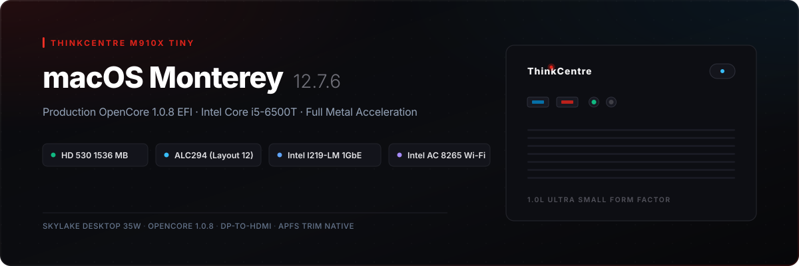

<p align="center">
  
</p>

# Lenovo ThinkCentre M910x Tiny — OpenCore macOS Monterey (12.7.x)

Complete, production-tested OpenCore EFI and deployment files for running **macOS 12 Monterey** natively on the **Lenovo ThinkCentre M910x Tiny** (with Intel Core i5-6500T, HD 530, ALC294, Intel I219-LM, and Intel AC 8265).

---

## 💻 Hardware Specifications

| Component | Hardware Details | Status |
| :--- | :--- | :---: |
| **System** | Lenovo ThinkCentre M910x Tiny (USFF) | ✅ Fully Working |
| **CPU** | Intel Core i5-6500T (4C/4T @ 2.50GHz - 3.10GHz, Skylake Desktop 35W) | ✅ Native Power Management (`SSDT-PLUG`) |
| **iGPU** | Intel HD Graphics 530 (`[8086:1912]`, rev 06) | ✅ 1536 MB VRAM with Metal / QE-CI |
| **Video Out** | Dual DisplayPort (DisplayPort to HDMI adapter supported) | ✅ 4K 60Hz Smooth Playback |
| **Audio** | Realtek ALC294 (`[10ec:0294]`) | ✅ Working (Layout ID `12`) |
| **Ethernet** | Intel I219-LM PCI Express Gigabit Ethernet (`[8086:15b7]`) | ✅ Full 1Gbps (`IntelMausi.kext`) |
| **Wi-Fi** | Intel Dual Band Wireless-AC 8265 (`[8086:24fd]`) | ✅ Native Apple Menu (`AirportItlwm.kext`) |
| **Bluetooth** | Intel Wireless Bluetooth Interface (`[8087:0a2b]`) | ✅ Working (`IntelBluetoothFirmware` + `BlueToolFixup`) |
| **Storage** | 512GB SATA / NVMe SSD | ✅ Full APFS TRIM Support |
| **RAM** | 8GB DDR4 2400MT/s (SO-DIMM) | ✅ Stable |
| **Boot Mode** | Pure UEFI Only (CSM Disabled, Secure Boot Disabled) | ✅ Standalone SSD Boot |

---

## 📂 EFI Architecture

```text
EFI/
├── BOOT/
│   └── BOOTx64.efi
└── OC/
    ├── ACPI/
    │   ├── SSDT-EC-USBX.aml      # Embedded controller & USB power injection
    │   └── SSDT-PLUG.aml         # Native Skylake CPU power management (PluginType=1)
    ├── Drivers/
    │   ├── HfsPlus.efi           # Fast Apple HFS+ filesystem driver
    │   ├── OpenRuntime.efi       # OpenCore runtime memory management
    │   └── ResetNvramEntry.efi   # NVRAM reset utility in boot picker
    ├── Kexts/
    │   ├── Lilu.kext             # Fundamental patcher engine (loads 1st)
    │   ├── VirtualSMC.kext       # Apple SMC emulator
    │   ├── SMCProcessor.kext     # CPU temperature & frequency monitoring
    │   ├── SMCSuperIO.kext       # Fan & motherboard sensor monitoring
    │   ├── WhateverGreen.kext    # Graphics driver & DP-to-HDMI framebuffer patches
    │   ├── AppleALC.kext         # Audio patch engine (ALC294 layout 12)
    │   ├── IntelMausi.kext       # Native Intel I219-LM Gigabit Ethernet driver
    │   ├── NVMeFix.kext          # APST power management for NVMe drives
    │   ├── AirportItlwm.kext     # Native Wi-Fi for Intel Wireless-AC 8265 (Monterey)
    │   ├── IntelBluetoothFirmware.kext # Firmware uploader for Intel Bluetooth
    │   ├── IntelBTPatcher.kext   # Bluetooth subsystem patcher
    │   ├── BlueToolFixup.kext    # Bluetooth stack fix for macOS Monterey+
    │   ├── USBToolBox.kext       # USB controller abstraction
    │   └── UTBMap.kext           # Custom USB port map for M910x Tiny chassis
    ├── OpenCore.efi              # OpenCore 1.0.8 Release bootloader
    └── config.plist              # Validated master OpenCore configuration
```

---

## ⚡ Key Configuration Highlights & Quirks Solved

1. **Display & Graphics (HD 530)**:
   - **No Analog VGA**: Apple removed analog VGA acceleration. You must use a **DisplayPort to HDMI** adapter or direct **DisplayPort**.
   - **DP-to-HDMI Patching**: Connectors are set to HDMI (`<00 08 00 00>`) with `enable-hdmi20 = <01 00 00 00>` and `igfxonln=1` in `boot-args` to prevent the monitor from going to sleep when switching from text to graphical mode.
2. **Audio (Realtek ALC294)**:
   - `alcid=12` (Layout 12) is specifically required for ThinkCentre Tiny boards to power the front 3.5mm headphone/headset combo jack and internal speaker. Layout 11 results in muted/dead headphone jacks.
3. **Ethernet (Intel I219-LM)**:
   - Must be set to `Onboard Ethernet Controller = Enabled` in BIOS (if disabled, the physical chip has zero power and dark LEDs).
   - `DisableIoMapper = True` in `Kernel -> Quirks` (with BIOS `VT-d = Disabled`).
4. **Bootloader Settings**:
   - `ReleaseUsbOwnership = True` handles Lenovo's OEM xHCI controller handoff.
   - `AppleCpuPmCfgLock = True` and `AppleXcpmCfgLock = True` safeguard against OEM MSR 0xE2 power locks.

---

## 🛠️ Step-by-Step Installation

For the complete BIOS setup checklist and installation commands, read the [Detailed Installation Guide](docs/BIOS_SETTINGS_AND_INSTALL.md).

### Quick Summary:
1. Configure BIOS (**F1**):
   - `Devices -> ATA Drive Setup -> Configure SATA as = AHCI`
   - `Devices -> Video Setup -> Select Active Video = IGD`, `DVMT = 64MB`
   - `Devices -> Network Setup -> Onboard Ethernet Controller = Enabled`
   - `Advanced -> CPU Setup -> VT-d = Disabled`
   - `Security -> Secure Boot = Disabled`
   - `Startup -> CSM = Disabled`, `Boot Mode = UEFI Only`
2. Create a FAT32 USB drive with this repository's `EFI` folder on the root.
3. Download macOS Monterey Recovery files using `python3 tools/macrecovery.py -b Mac-FFE5EF870D7BA81A -m 00000000000000000 download` and place them into `com.apple.recovery.boot/` on the USB drive.
4. Boot USB via **F12**, erase target SSD as `APFS / GUID Partition Map` in Disk Utility, and install macOS Monterey.
5. Copy `EFI/` to your SSD's EFI partition (`disk0s1`) to boot permanently without the USB drive.

---

## 📄 License & Credits
- [Acidanthera](https://github.com/acidanthera) for OpenCorePkg, Lilu, VirtualSMC, WhateverGreen, AppleALC, and IntelMausi.
- [OpenIntelWireless](https://github.com/OpenIntelWireless) for itlwm and IntelBluetoothFirmware.
- [USBToolBox](https://github.com/USBToolBox) for custom USB port mapping.
- [Dortania](https://github.com/dortania) for the comprehensive OpenCore guides.
